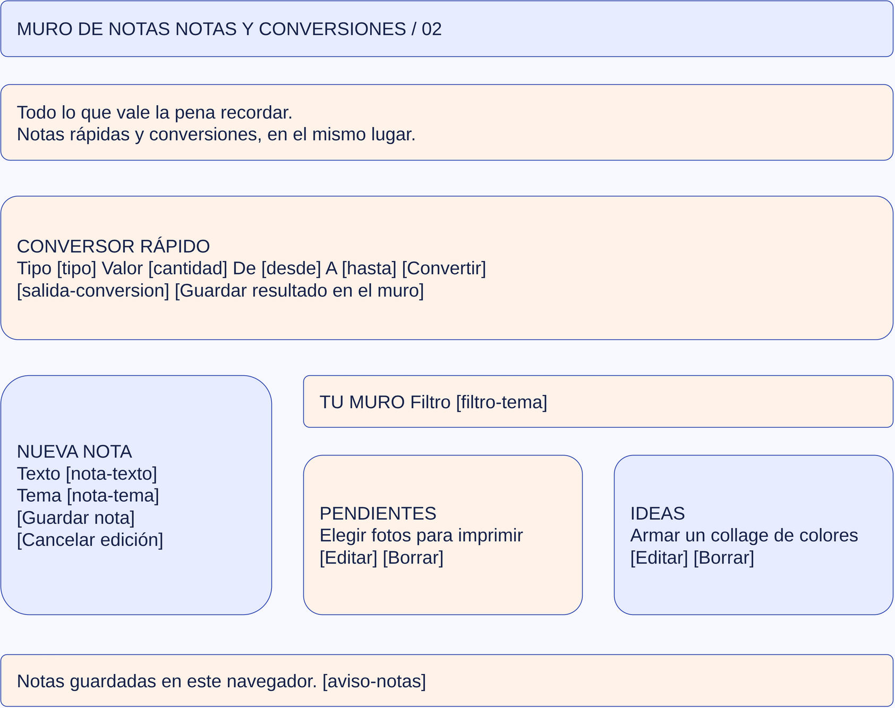
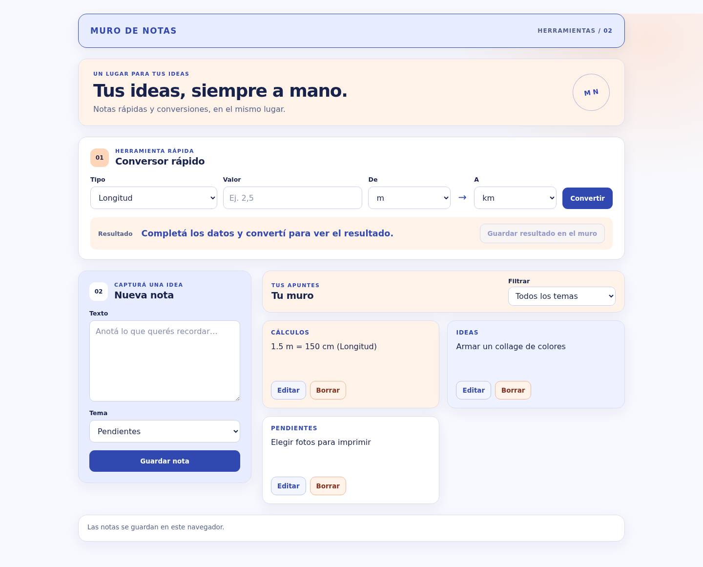

# Muro de notas

## 🧩 Datos generales

| Campo | Detalle |
| --- | --- |
| Integrante 1 | Micaela Joaquin |
| Integrante 2 | No corresponde: trabajo individual |
| Modelos de IA utilizados | ChatGPT; GPT-6 Luna (asistencia de implementación y revisión) |
| Tecnologías del proyecto | HTML5, CSS3, JavaScript, Markdown y GitHub |
| Link del repositorio | https://github.com/2023micaelajoaquin-droid/pizarron-de-estudio |

## Descripción

Aplicación independiente para crear, editar, eliminar y filtrar notas, junto con un conversor de unidades de longitud, masa y temperatura. Las notas se almacenan localmente en el navegador. Una conversión se puede guardar como nota. La interfaz conserva su distribución y colores; las categorías se muestran con etiquetas breves y claras.

## Encargo funcional

Registro original del desarrollo; los prompts se conservan tal como se utilizaron.

```text
Creá Muro de repaso para Club Punto y Aparte en index.html, style.css y script.js. Según el boceto, colocá el conversor horizontal arriba y, debajo, un editor de notas a la izquierda y un muro de tarjetas a la derecha. Diseño gráfico azul cobalto #3048af, durazno #ffd5ba y fondo #f8f9ff, tipografía sans serif, bordes redondeados. Crear, editar, borrar y filtrar notas por Pendientes, Repaso y Cálculos; persistir con una clave localStorage propia de este proyecto. IDs nota-texto, nota-tema, filtro-tema y aviso-notas. Conversor con IDs tipo, cantidad, desde, hasta, salida-conversion; convertir longitud m/km/cm, masa g/kg y temperatura C/F/K. Rechazar vacíos, números no finitos, resultados no finitos y temperaturas inferiores al cero absoluto. Guardar un resultado vigente como nota e invalidarlo al cambiar la entrada o las unidades. Manejar almacenamiento corrupto o inaccesible con avisos claros. Si se borra la nota que se estaba editando, cancelar esa edición. Usar texto seguro, etiquetas accesibles, teclado y adaptación desde 320 px, sin frameworks.
```

## Prompt de corrección

```text
Revisión del coordinador detecta root fuera de alcance en factory: start usa root.localStorage pero factory se define como argumento fuera del alcance del parámetro root de la IIFE. Eso hace que siempre se tome almacenamiento como no disponible. Corregí pasando root a factory y recibiéndolo o usando globalThis explícito. También en deleteNote no se informa fallo persist() (aviso éxito aunque no guarda): corregilo.
```

## Ajuste del formulario

**Error observado:** al guardar una nota, el muro seguía vacío. El script buscaba `form-nota` por ID, pero el formulario solo tenía esa clase y la inicialización terminaba antes de conectar los eventos.

**Prompt de corrección:**

> Agregá id="form-nota" al formulario de notas para que coincida con el selector del script y comprobá crear una nota y recuperarla al recargar.

**Resultado:** el formulario conecta sus eventos, guarda las notas y las recupera al recargar.

## Estado

Cambio local realizado. Publicación pendiente por decisión de la persona usuaria.

En este proyecto, la categoría histórica `repaso` se muestra como **Ideas** para distinguirla de `pendientes`, que se muestra como **Pendientes**.

## Capturas actuales

Boceto de la interfaz:



Aplicación funcionando con datos de ejemplo:



[Ver captura móvil](evidencias/aplicacion-movil.png).

Estas capturas corresponden a la versión local. El repositorio y el sitio publicados todavía conservan la versión anterior.
